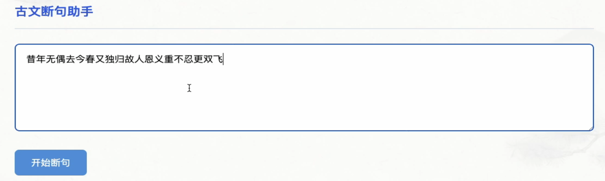
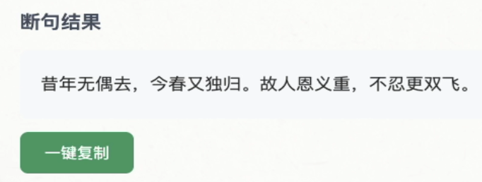
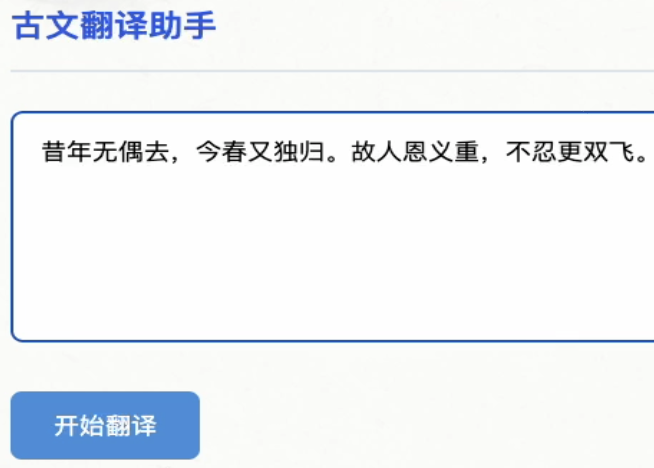
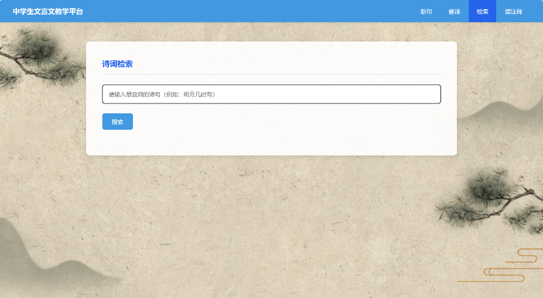
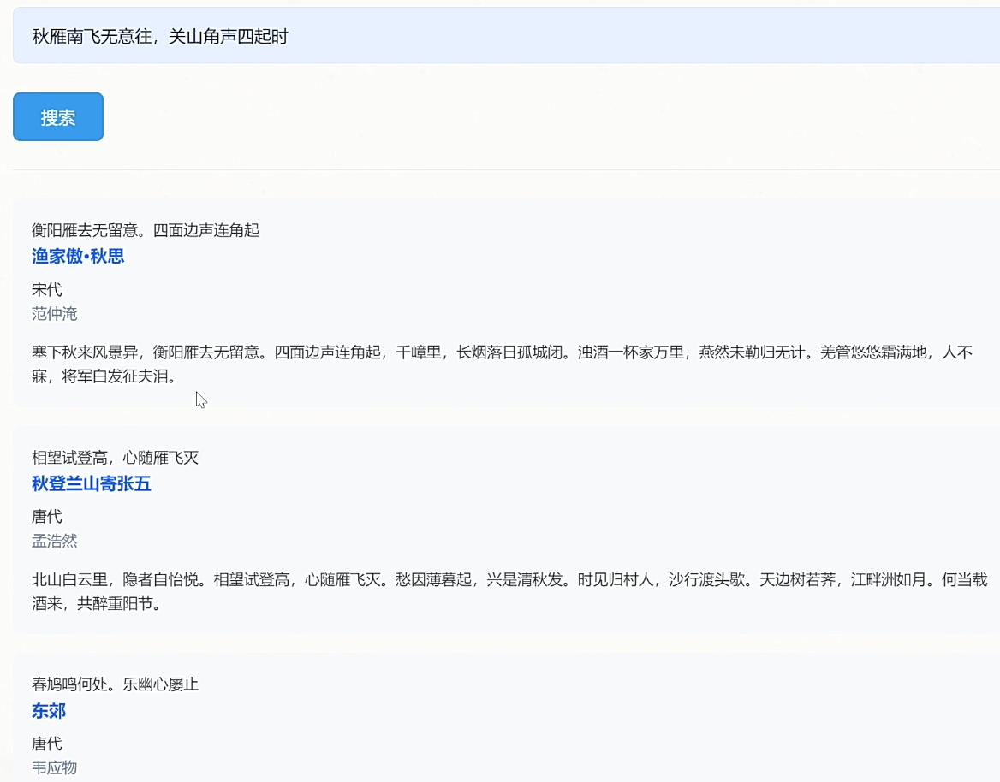
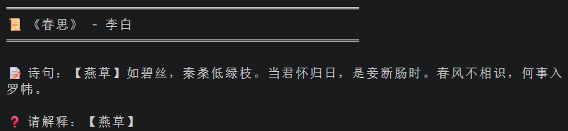
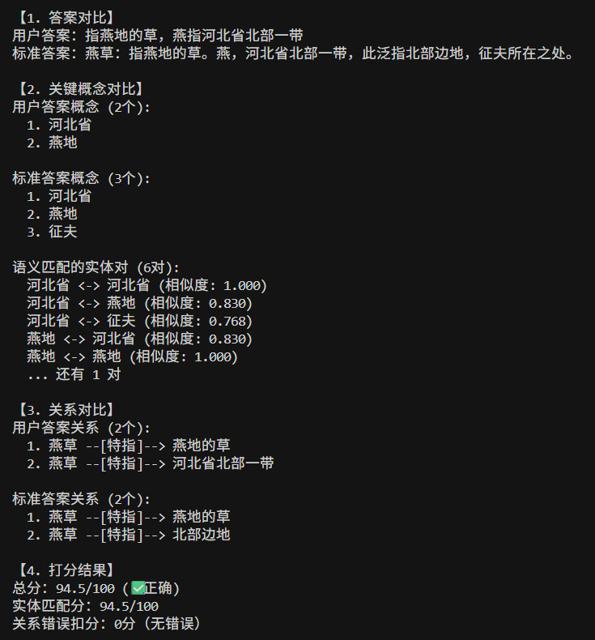
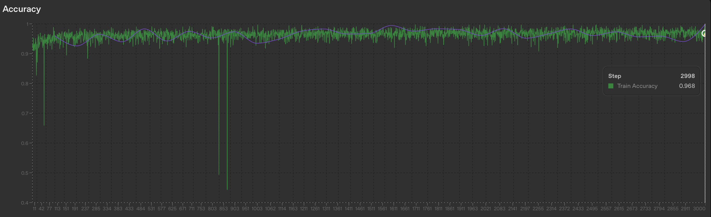

# 고전 중국어 학습을 위한 LLM 미세조정·의미 검색 플랫폼

[English](README.md) | [한국어](README.ko.md) | [简体中文](README.zh-CN.md)

중학생의 문언문 학습을 지원하기 위해 GPT-4o-mini 미세조정 모델과 BERT 기반 의미 검색을 FastAPI로 통합한 《텍스트 마이닝 기술》 수업 프로젝트입니다.

## 프로젝트 개요

### 문제정의

중학생은 문언문을 학습할 때 단어의 뜻을 이해하거나 기억이 불완전한 시구를 찾는 데 어려움을 겪습니다. 구절 나누기와 번역 연습에서도 즉각적인 피드백이 필요하므로, 이 프로젝트는 이러한 학습 활동을 한 플랫폼에서 지원하고자 했습니다.

### 해결방법

WenyanGPT 19,644개와 WenyanBench Translation 5,013개 자료를 활용해 GPT-4o-mini 기반 구절 나누기·번역 모델을 각각 지도 미세조정했습니다. 고시문 910개에는 BERT-Ancient-Chinese 기반 의미 검색을 적용하고, BERT-Base-Chinese와 규칙 기반 개체·관계 추출을 활용한 어휘 풀이 채점 기능을 구성하여 FastAPI로 통합했습니다.

### 결과물 활용

사용자는 구두점이 없는 문언문에 문장부호를 추가하고, 문언문을 현대 중국어로 번역하며, 입력한 시구와 의미가 유사한 작품을 검색할 수 있습니다. 어휘 풀이 퀴즈에서는 문맥에 맞는 단어의 뜻을 작성하고, 표준 답안과의 비교 및 자동 채점 피드백을 확인할 수 있습니다.

## 주요 결과

| 구분 | 결과 및 확인 범위 |
| --- | --- |
| 구절 나누기 | 학습 18,000개·검증 1,644개로 분할. Step 2,998에서 Train Accuracy 0.968(96.8%), 보고서 본문의 Train Loss 약 0.099 |
| 문언문 번역 | 5,013개 병렬 자료로 전용 모델 구축. 보고서가 설명한 학습 후반 Accuracy는 약 0.7(약 70%) 수준이며 변동 존재 |
| 의미 검색 | 고시문 910개를 대상으로 슬라이딩 윈도우·벡터 유사도 기반 검색 구현 |
| 어휘 풀이 퀴즈 | 무작위 출제, 표준 답안 비교, 개체 의미 매칭과 관계 오류에 따른 자동 채점 구현 |
| 기능 통합 | FastAPI로 구절 나누기·번역·검색·어휘 풀이 퀴즈 통합 |

학습 정확도와 번역 Accuracy는 학습 과정의 지표입니다. 번역의 약 70%는 보고서의 근사 서술이며, 번역 품질을 사람의 정답률로 해석하는 수치는 아닙니다.

**개인 담당 범위:** 데이터 전처리와 JSONL 구축을 담당하고, 구절 나누기·번역 모델의 미세조정 및 검증을 독립적으로 수행했습니다. BERT 의미 검색과 엔드투엔드 플랫폼 통합에도 참여했습니다.

## 기능별 화면과 사용 흐름

### 1. 문언문 구절 나누기

구두점이 없는 원문을 입력하면 문장부호가 추가된 결과를 확인할 수 있습니다.

**원문 입력 — 보고서 그림 1:** ‘昔年无偶去今春又独归故人恩义重不忍更双飞’를 입력한 화면입니다. 사용자는 입력란 아래의 실행 버튼으로 구절 나누기를 요청합니다.

**처리 결과 — 보고서 그림 2:** ‘昔年无偶去，今春又独归。故人恩义重，不忍更双飞。’처럼 문장부호가 추가된 결과와 복사 버튼이 표시됩니다.

### 2. 문언문 번역

문언문 원문을 입력하고 현대 중국어 번역문을 원문과 나란히 확인할 수 있습니다.

**번역 입력 — 보고서 그림 4:** 번역할 문언문을 입력하는 화면입니다. 구절 나누기 예시와 같은 시구가 문장부호를 포함한 형태로 입력되어 있습니다.

**번역 결과 — 보고서 그림 5:** 왼쪽에는 원문, 오른쪽에는 생성된 현대 중국어 번역을 표시합니다. 원문의 표현과 모델의 해석을 대조할 수 있는 출력 예시입니다.

### 3. 유사 시구 의미 검색

시구를 검색하면 관련 구절과 작품 제목·시대·작가·본문을 확인할 수 있습니다.

**검색 화면 — 보고서 그림 6:** 플랫폼 상단에 구절 나누기·번역·검색·어휘 풀이 메뉴가 있고, 본문에는 검색어 입력란과 검색 버튼이 배치되어 있습니다.

**검색 결과 — 보고서 그림 7:** ‘秋雁南飞无意住，关山角声四起时’를 검색했을 때 범중엄의 《渔家傲·秋思》, 맹호연의 《秋登兰山寄张五》 등이 반환된 예시입니다. 검색 결과에는 일치 후보 구절과 작품 정보가 함께 표시됩니다.

### 4. 어휘 풀이 퀴즈와 자동 채점

다음 두 이미지는 보고서에 수록된 문제 제시 및 분석 출력 화면입니다.

**문제 제시 — 보고서 그림 8:** 이백의 《春思》에서 ‘燕草’를 풀이하도록 요청합니다. 사용자는 시구의 문맥을 바탕으로 해당 어휘의 뜻을 작성합니다.

**답안 분석 — 보고서 그림 9:** 사용자 답안과 표준 답안, 추출된 핵심 개념, 개체 간 의미 유사도, 관계 비교 결과를 표시합니다. 이 예시에서는 개체 매칭 점수 94.5점, 관계 오류 감점 0점으로 총 94.5/100점과 ‘정답’ 판정이 출력되었습니다. 이는 한 답안의 채점 예시입니다.

## 개인 기여도

- **학습 데이터 준비:** 구절 나누기·번역용 데이터를 전처리하고 미세조정에 사용할 JSONL을 구축했습니다.
- **구절 나누기 모델:** GPT-4o-mini 미세조정과 모델 검증을 독립적으로 수행했습니다.
- **번역 모델:** GPT-4o-mini 미세조정과 모델 검증을 독립적으로 수행했습니다.
- **의미 검색:** BERT 기반 의미 검색 구현에 참여했습니다.
- **플랫폼 통합:** 개별 기능을 연결하는 엔드투엔드 플랫폼 통합에 참여했습니다.

## 데이터 및 전처리

| 데이터 | 규모 | 구성 및 용도 |
| --- | ---: | --- |
| WenyanGPT 구두점 자료 | 19,644개 | 전처리 후 학습 18,000개·검증 1,644개로 분할 |
| WenyanBench Translation | 5,013개 | 문언문 원문과 현대 중국어 번역의 병렬 자료 |
| 고시문 웹 수집 자료 | 910개 | 제목·작가·시대·본문·번역·주석 등 메타데이터를 포함하며, 검색과 어휘 풀이 퀴즈에서 공유 |

구절 나누기 자료를 instruction·input·output 구조로 정리하고, 여러 지시문 표현을 포함했습니다. 이후 system·user·assistant 역할을 갖는 messages 기반 JSONL로 변환하여 작업 지시, 원문, 정답을 구성했습니다.

번역 자료도 동일한 대화형 JSONL 구조로 구성했습니다. system에는 번역 조건, user에는 문언문 원문, assistant에는 대응하는 현대 중국어 번역을 배치했습니다.

## 방법론 및 시스템 구조

### 1. 과제별 GPT-4o-mini 지도 미세조정

구절 나누기는 원문에 적절한 문장부호를 추가하는 작업으로 구성했습니다. 보고서에서는 출력 형식과 문장부호 삽입 규칙에 모델을 적응시키려는 목적으로 지도 미세조정을 선택했다고 설명합니다.

번역은 문언문과 현대 중국어의 병렬 자료로 별도 모델을 미세조정했습니다. 원문의 의미와 정보를 보존하고 번역 표현의 일관성을 확보하는 것이 설계 목표였습니다. 두 과제 모두 OpenAI fine-tuning API를 사용했습니다.

### 2. BERT-Ancient-Chinese 의미 검색

고전 중국어를 대상으로 사전학습된 모델을 검색 자료의 언어 특성에 맞춰 선택했습니다. 고시문을 슬라이딩 윈도우로 나누고 평균 풀링으로 임베딩을 구성한 뒤, 질의 벡터와 후보 벡터 사이의 코사인 유사도를 계산했습니다.

보고서는 전체 작품을 하나의 벡터로 표현했을 때 짧은 질의에 대응하는 구절을 찾기 어려웠고, 반구·한 구·두 구 단위의 분할을 탐색했다고 설명합니다. 최종 구조에서는 문장부호를 경계로 중첩된 구간을 만들고 길이에 따라 Window_1~Window_4에 저장했습니다.

질의의 문장부호 수에 따라 검색할 벡터 저장소를 선택합니다. 유사도 상위 후보에서 같은 작품의 중복을 제거한 후 서로 다른 작품의 Top-K 결과를 반환합니다.

### 3. 어휘 풀이 채점

910개 고시문 자료의 주석에서 문제를 무작위로 출제합니다. 사용자 답안과 표준 답안에는 Jieba 단어 분할·품사 태깅, 명사 중심의 후보 추출, 불용어·길이 필터와 규칙을 적용하여 개체를 구성합니다.

관계 추출은 ‘정의’, ‘속성’, ‘지리적 위치’ 등 8종의 사전 정의 패턴을 사용합니다. BERT-Base-Chinese는 추출한 개체를 768차원 벡터로 표현하여 의미 유사도를 계산하는 역할을 맡습니다.

- **개체 매칭:** 각 표준 개체에 대해 가장 유사한 사용자 개체를 선택하고, 코사인 유사도 0.7 이상을 유효 매칭으로 처리합니다.
- **관계 오류:** 관계 유형이 같고 주어 유사도가 0.7 이상인데 목적어 유사도가 0.7 미만이면 오류로 판정합니다.
- **총점:** 유효 매칭 유사도의 평균 × 100 − 관계 오류 수 × 15점. 최저점은 0점이며, 70점 이상이면 ‘정답’으로 판정합니다.

### 4. 플랫폼 통합

FastAPI로 구절 나누기, 번역, 의미 검색, 어휘 풀이 퀴즈를 통합했습니다. 학습자는 원문 입력, 결과 확인, 답안 작성, 채점 피드백 확인을 통해 개별 학습 활동을 수행할 수 있습니다.

## 평가 방법 및 결과

### 구절 나누기 모델

| 항목 | 보고된 내용 |
| --- | --- |
| 자료 분할 | 학습 18,000개 / 검증 1,644개 |
| 관측 시점 | Step 2,998 |
| Train Accuracy | 0.968 = 96.8% |
| Train Loss | 약 0.099 — 보고서 본문 서술 |
| 해석 범위 | 학습 데이터에서 관측된 지표 |

**학습 곡선 — 보고서 그림 3:** 화면의 툴팁에서 Step 2,998과 Train Accuracy 0.968을 확인할 수 있습니다. 이 이미지는 Accuracy 곡선이며, Train Loss 약 0.099는 보고서 본문에 제시된 값입니다.

### 번역 모델

| 항목 | 보고된 내용 |
| --- | --- |
| 전체 자료 | 문언문·현대 중국어 병렬 샘플 5,013개 |
| 학습 후반 Accuracy | 약 0.7(약 70%) 수준, 상하 변동 존재 |
| 근거 | 보고서 2.2.3절의 학습 과정 설명 |
| 해석 범위 | 학습 과정의 참고 지표이며 번역 품질의 종합 점수로 해석하기 어려움 |

번역은 같은 원문에 여러 적절한 표현이 가능하므로, Accuracy만으로 의미 보존이나 자연스러움을 판단하기 어렵습니다. 보고서에서는 BLEU·ROUGE와 사람의 검토를 함께 활용하는 평가를 후속 과제로 제시했습니다.

보고서 표 3에는 한 샘플의 BLEU-1 0.4340, BLEU-2 0.2795, BLEU-3 0.1999, BLEU-4 0.1481이 데이터 필드 예시로 제시됩니다. 이 값들은 해당 예시의 수치이며 전체 평가 자료의 평균 성능을 뜻하지 않습니다.

### 의미 검색 및 어휘 풀이 채점

의미 검색은 보고서의 질의·반환 결과 예시로 동작을 확인할 수 있습니다. 정량 성능을 평가하려면 관련성 정답이 있는 질의 집합을 구성하고 Precision·Recall 등으로 측정할 필요가 있습니다.

어휘 풀이 채점 화면의 94.5/100점은 사용자 답안 한 건에 계산된 점수입니다. 채점 시스템 자체의 정확도나 사람의 평가와의 일치율은 별도의 평가 대상으로 다뤄야 합니다.

## 한계 및 개선 방향

- **일반화 평가:** 구절 나누기의 96.8%는 학습 정확도입니다. 별도 평가 자료에서의 구절 경계 지표와 오류 분석을 통해 실제 입력에 대한 성능을 확인할 필요가 있습니다.
- **번역 품질 평가:** 의미 보존·누락·표현 적절성을 평가할 기준과 사람의 검토를 보완할 필요가 있습니다.
- **검색 범위:** 질의 길이에 따라 하나의 윈도우 저장소를 선택하므로, 다른 길이의 구간에 있는 관련 결과를 놓칠 수 있습니다. 다중 윈도우 검색과 어휘·벡터 혼합 검색은 향후 검토 방향입니다.
- **검색 사용성:** 초기 모델 로딩 지연과 현대 중국어로 표현한 질의에 대한 대응 한계가 보고되었습니다.
- **채점 규칙:** 개체·관계 추출이 규칙에 의존하므로 특수 표현·전고·복잡한 동의 표현에 대응하려면 규칙 보완이 필요합니다.
- **학습 개인화:** 현재의 무작위 출제에 난이도 정보와 학습 이력을 결합하는 방식은 향후 개선 방향입니다.
